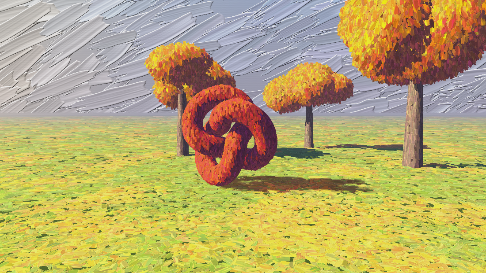
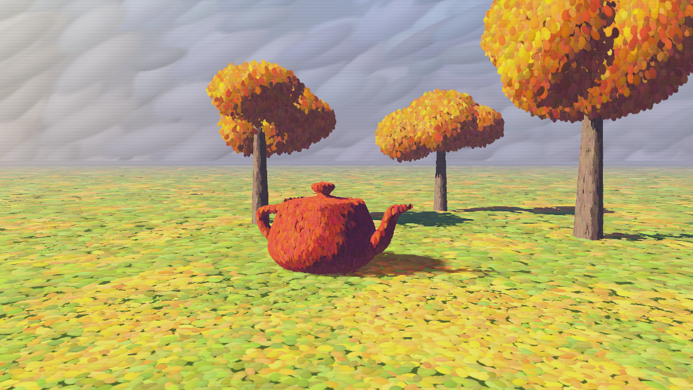
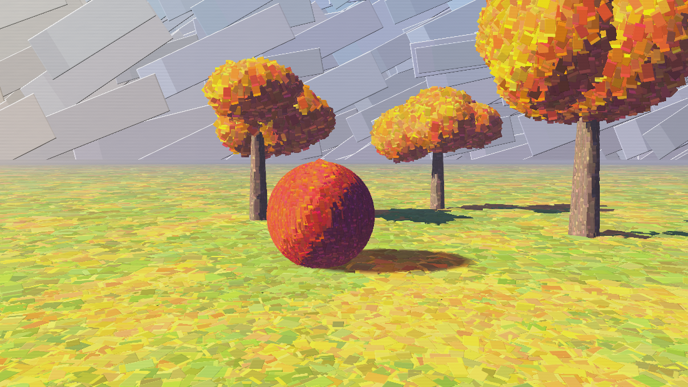

# gaussixel

A sandbox for the painterly rendering technique in [Oil paint](https://patch.gg/blendi/oil-paint) by @blendi
on Patch: a three.js scene drawn stroke by stroke, with nothing filtered after the fact.



## What the technique is (and isn't)

It is not gaussian splatting, though it is a close cousin. Nothing is reconstructed from photos and nothing is
blended by sorted alpha. The picture is made of **dabs**: instanced quads, each pinned to a point in the world,
turned to run along a world direction, carrying one mixed colour, and stamped with a procedural brush mark.

| | Gaussian splat | Dab (this technique) |
|---|---|---|
| Primitive | anisotropic 3D gaussian | oriented card, or a patch lying on a surface |
| Where they come from | optimised from photos | generated: scattered on meshes, grids, or by code |
| Colour | spherical harmonics, view dependent | one of three paint mixes (light / half-tone / shade), picked per dab |
| Footprint | gaussian falloff | brush-mark sheet (paint presence, thickness, streak) |
| Blending | sorted alpha | opaque, depth-tested, alpha-to-coverage; fixed order, never view-sorted |
| Level of detail | none built in | sizes clamped in screen pixels, so far things get fewer, larger touches |

To make the kinship concrete the sandbox has a **gaussian** brush: the same pipeline with a soft blob footprint.

| `?brush=gaussian&subject=teapot` | `?brush=card&subject=sphere` |
|---|---|
|  |  |

## Run it

```bash
npm install
```

```bash
npm run dev
```

Then open http://127.0.0.1:5173. Drag to orbit, wheel to zoom, **drop a `.glb`** on the page to paint your own
model (its textures are ignored: colour comes from the palette). `H` hides the panels.

URL switches: `?brush=bristle|gaussian|card`, `?subject=knot|teapot|sphere|box|none`, `?still`, `?clean`.

Without a GPU or a browser to hand (a cloud session, CI), take a still headless:

```bash
npm run build
```

```bash
node tools/shot.mjs shots/out.png --query "brush=gaussian&subject=teapot" --size 1280x720
```

## What to play with

The panel exposes the knobs that make the look:

- **Brush**: the mark sheet (bristle / gaussian / bare card), impasto (the raking light on the paint's
  thickness), the canvas weave.
- **Light and air**: sun direction (re-bakes the still shade), mist, the sun standing in the mist, wind, the
  glaze a moving shadow lays on the ground.
- **Subject**: dab count, size in metres, the least and most size in pixels (this is the distance
  simplification), grain (which way strokes run over the surface), broken colour, lift, and the three mixes.
  Turn the underpainting or the strokes off to see what each contributes.
- **Trees**, **Ground**: the same for free-standing dabs and for the endless ground.

## Where things are

| | |
|---|---|
| `src/oilpaint/` | The painter, vendored from the article's repo (MIT, Patch). See `src/oilpaint/VENDORED.md` for the one change. `dabs.js` is the heart: the `Dab` struct and the vertex shader that places it. |
| `src/sandbox/surface.js` | Dabs scattered on any geometry, all parameters live; the underpainting material. |
| `src/sandbox/trees.js` | Dabs of your own: the shortest complete example of writing a `makeDab`. |
| `src/sandbox/ground.js` | The endless ground on `groundRings`. |
| `src/sandbox/brushes.js` | Alternative brush sheets. Add one here to try a new footprint. |
| `src/sandbox/sky.js`, `palette.js` | Sky wash and strokes; palettes as live uniforms. |
| `src/main.js` | The scene, the panel, the loop. `window.sandbox` exposes everything to the console. |
| `tools/shot.mjs` | Headless still via Playwright (software GL works). |

## Writing a new kind of dab

Everything goes through `makeDab`, GLSL that fills in one `Dab` per instance:

```js
const mesh = dabMesh(dabGeometry(count, { aPos: [positions, 3] }), dabMaterial(shared, {
  head: `in vec3 aPos;`,
  body: `void makeDab(inout Dab d) {
    vec4 r = hash4(float(gl_InstanceID));
    d.pos = aPos;                       // where it is pinned
    d.dir = vec3(0.0, 1.0, 0.0);        // the way the stroke runs
    d.size = vec2(0.2, 0.5);            // across and along, metres
    d.c1 = hazed(jitter(paint3(LIGHT, HALF, SHADE, sunAt(aPos), r.x), r.yzw, 0.5), aPos);
    d.c2 = d.c1 * 1.15;                 // the colour streaked into it
  }`,
}));
```

Helpers available in there: `paint3`, `jitter`, `hazed`, `sunAt`, `lampAt`, `gustAt`, `heightAt`, `normalAt`,
`hash4`. Flags: `d.lie` (lies flat on `d.nrm`), `d.base` (pinned by its foot), `d.glaze` (takes the moving
shadow per pixel), `d.cell` (pick a brush mark), `d.alive` (0..1, grows in).

## Limits

WebGL2 only. Measured upstream at about 4.5 ms a frame on an RTX 4090 at 1080p for a full scene; the sandbox
draws about 450k dabs by default. The headless tool uses software GL and takes around 40 s a still.

## Credits

Technique and `src/oilpaint/`: [blendi/oil-paint](https://patch.gg/blendi/oil-paint), MIT, Copyright (c) 2026
Patch. `src/sandbox/sky.js` and `ground.js` are adapted from that repo's demo scenes. three.js and lil-gui are MIT.
